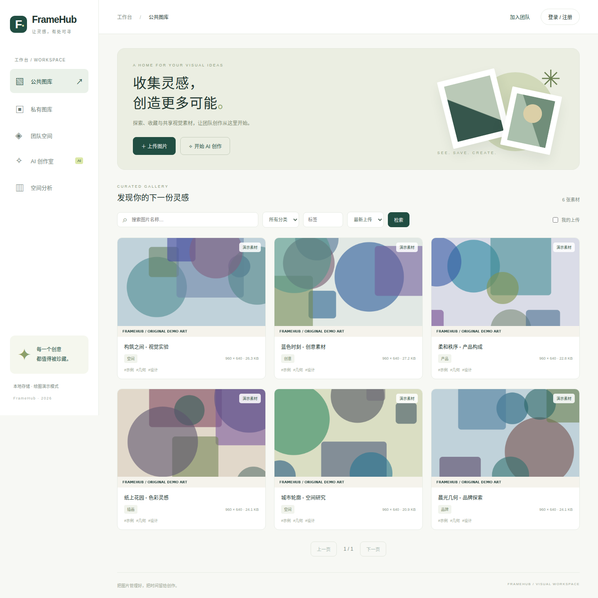

# FrameHub · 企业级 AI 图片管理系统

[](https://github.com/ZhouHuimin0111/enterprise-ai-gallery/actions/workflows/ci.yml)

面向 Java 后端求职的完整作品：公共图库、私有图库、团队共享图库，配套独立前端、双实例部署、接口文档、自动化测试与故障恢复脚本。

技术栈：Java 21、Spring Boot 3.5、MyBatis Plus 3.5、MySQL 8.4、Redis 7.4、腾讯云 COS Java SDK、阿里云百炼 HTTP 异步 API、Hutool、Knife4j/OpenAPI 3、WebSocket、Docker Compose、JUnit 5、Testcontainers、Playwright。



[查看桌面与手机截图](docs/screenshots/) · [测试结果与可核验证据](docs/VERIFICATION.md) · [简历描述](docs/RESUME.md)

## 运行

需要 Docker Engine / Docker Desktop（Linux 容器）和 Docker Compose v2。端口 8080 仅绑定本机。无需云账号即可运行完整演示：

```bash
git clone https://github.com/ZhouHuimin0111/enterprise-ai-gallery.git
cd enterprise-ai-gallery
docker compose up -d --build --wait --wait-timeout 300
```

打开 <http://localhost:8080>。普通用户自行注册。**本地演示管理员**：`admin` / `DemoAdmin2026!`。管理员密码只在首次创建时生效；生产环境必须替换 `.env` 配置并关闭演示素材。

API 文档：<http://localhost:8080/doc.html>；OpenAPI JSON：<http://localhost:8080/v3/api-docs>。

默认 `STORAGE_MODE=local`，图片存储于两个实例共享的 Docker volume；`AI_MODE=demo` 生成有明确标记的程序化图形，只演示异步任务流程，**不是真实 AI 生成**。真实云适配器已实现，按[云接入说明](docs/CLOUD_SETUP.md)切换。

## 业务功能

| 模块 | 行为 |
| --- | --- |
| 公共图库 | 匿名浏览/检索已审核图片，登录上传；待审核或拒绝图片只对上传者和公共管理员可见；编辑后重新审核 |
| 私有图库 | 每人一个 100 MB 空间，图片、二进制内容、检索、统计均隔离；全局管理员不能绕过私有权限 |
| 团队空间 | 500 MB 空间，OWNER / ADMIN / EDITOR / VIEWER 四角色，一次性 48 小时邀请、角色调整与移除、操作审计 |
| 图片管理 | 真实 PNG/JPEG 检测，10 MB / 1600 万像素限制，重编码移除元数据；分类/JSON 标签/尺寸/排序/分页检索；原图下载、裁剪与旋转 |
| 批量管理 | 最多 50 张同空间图片的批量分类/标签/删除；先检查权限与版本，数据库事务保证全部成功或全部回滚 |
| 实时协作 | 一次性握手票据，WebSocket + Redis Pub/Sub 跨实例广播；图片版本 CAS 防覆盖；15 秒快照补偿消息丢失与成员撤销 |
| 空间分析 | 真实配额、分类分布、近 30 天上传趋势、成员贡献、管理员审计，无虚构统计 |
| AI 创作 | 持久化任务、请求幂等、后台提交与轮询、结果归档；应用重启后继续已知任务；不确定提交不自动重试收费调用 |
| 账号与空间管理 | 更新显示名、核对旧密码改密并使旧 Token 失效；管理员启停/逻辑删除账号；所有者重命名或删除空空间 |

## 后端实现重点

- 可复用模板层：`ApiResponse`、`ErrorCode`、`BusinessException`、`GlobalExceptionHandler`、参数校验、可信来源 CORS、Redis Token 会话、统一 OpenAPI 配置。
- MyBatis Plus `@MapperScan` + `BaseMapper` + `LambdaQueryWrapper`；分页插件限制每页 50，排序列白名单，JSON 标签使用绑定参数；`@TableName(autoResultMap=true)` / `JacksonTypeHandler` 映射 JSON 标签。
- MySQL 唯一约束保证每人一个私有空间、成员不重复、AI 幂等键不重复；成员表同时覆盖 `(space_id,user_id)` 与 `(user_id,space_id)` 检索方向。
- `UPDATE space ... WHERE used_bytes + ? BETWEEN 0 AND max_bytes` 原子核算容量，与图片创建/裁剪/删除同事务；版本 CAS 失败时配额也回滚。
- 公开搜索 Cache Aside，版本化缓存键 + 提交后失效 + 30 秒 TTL；私有/团队查询先鉴权且不共享缓存。Redis 会话使用原子刷新，缓存和会话键分离。
- 图片进入对象存储前先写持久化清理意图，图片记录提交后清除；失败上传、旧图片、删除对象进入 MySQL 清理队列，30 分钟宽限后可重试清理。
- COS 私有桶，经鉴权代理读取，避免裸 URL 泄露私有图片。百炼生成结果仅从配置的 HTTPS 域名读取，拒绝重定向和私网地址，检查大小与图片格式。

## 测试

```bash
# Java 21 + Maven；verify 需要 Docker 以运行 Testcontainers
./mvnw verify
# 已启动 Compose 后
npm ci
node scripts/e2e.mjs
bash scripts/assert-database.sh
npx playwright install chromium
npm run test:ui
```

CI 在隔离 Ubuntu 环境执行真实 MySQL/Redis 并发测试、双实例 HTTP/WebSocket 链路、AI 演示任务双应用重启恢复、独立 SQL 一致性核验、桌面/手机 Chromium 流程，并归档报告与截图。

已通过 30 项后端测试与 8 项浏览器测试，双实例 E2E、任务重启恢复和三项 SQL 一致性检查均通过。具体提交、运行链接和原始输出见[验证记录](docs/VERIFICATION.md)。

`scripts/e2e.mjs` 会创建测试账号、图片和团队，重启应用，适合全新演示或 CI 环境。真实 COS/百炼测试需要个人云凭据；默认测试不会产生云费用。适配器单元测试只能证明请求/处理契约，不能替代真实云联调。

## 文档与边界

- [架构与一致性](docs/ARCHITECTURE.md)
- [云接入与环境变量](docs/CLOUD_SETUP.md)
- [API 与权限矩阵](docs/API.md)
- [运行、排障与备份](docs/RUNBOOK.md)
- [简历描述与面试准备](docs/RESUME.md)

这是采用企业常见权限与可靠性设计的作品项目，不宣称已在生产企业部署。当前单 MySQL、单 Redis，不能代表跨机房高可用；Redis Pub/Sub 不保证消息必达，DB 版本与定期快照负责补偿；协作是有冲突检测的图片/元数据编辑，不是 CRDT 像素级多人画布。

MyBatis X 是可选 IDE 插件，见云接入文档末尾；项目运行不依赖它。动态查询采用 Lambda 和参数化 Mapper，未为展示技术而开放任意 `SqlRunner` 原始 SQL。Spring Boot 3 使用 `@Operation`，避免旧 Swagger 2 注解兼容问题。
