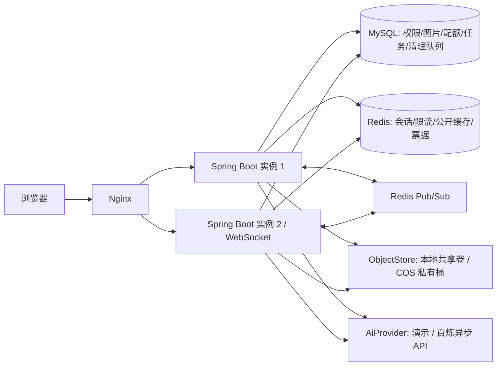
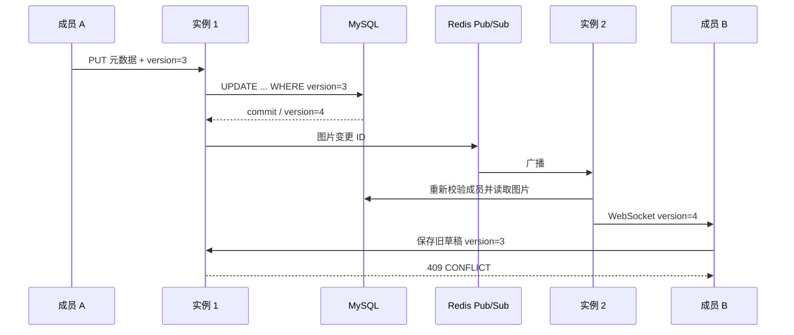

# 架构与一致性

## 图片与配额

上传先鉴权、验证/重编码，再持久化清理意图和写对象。数据库事务中重新鉴权、条件更新空间配额、插入图片、移除该对象的清理意图、写审计。配额条件包含上下限，防止并发超额与重复释放。

对象不是数据库事务资源。对象写成功而 DB 失败的窗口由持久化 `storage_gc` 补偿；删图只在 DB 中扣减配额并标记清理，后台延迟删除对象。宽限 30 分钟大于单次网络和 DB 超时；参考计数不为零的对象不会被删。数据库/对象存储永久数据丢失仍需要备份与人工核对。

裁剪替换使用新 object key，事务中同时调整字节差值与图片版本。旧对象进入清理队列。删除使用版本条件，CAS 失败回滚配额。批量操作限定同一空间、按 ID 排序，并采用整批事务。

## 会话、权限和检索

随机 32 字节 Token，只将其 SHA-256 作为 Redis key；值为用户 ID 与 auth_version。Lua GET+EXPIRE 原子滑动刷新 30 分钟，注销直接删除共享键。每次请求读取用户最新角色、启停状态和版本；改密/停用递增 auth_version，使所有旧 Token 失效。权限服务再检查空间成员。系统管理员只管理公开图库，不天然拥有私人/团队资料。

标签采用 JSON 数组，绑定 JSON_CONTAINS 参数；排序白名单、查询长度与分页限制。不存在任意 SQL 拼接入口。公共查询只缓存 APPROVED 数据；上传者查询待审资料使用 `mine=true` 且不共用缓存。编辑/审核提交后递增缓存版本，旧键 30 秒过期。Redis 失效通知失败或旧读回填时只承诺 TTL 范围内最终一致。

## 协作

HTTP POST 获取 30 秒一次性票据，握手 Redis GETDEL，检查 Origin/成员身份。WebSocket 只传当前图片的快照/变更，修改仍走带 version 的 HTTP API。

Pub/Sub 非可靠队列，15 秒 DB 快照修复丢失广播。成员撤销之后的新操作立即重新检查 DB；已连接 socket 在下次广播/快照时关闭，最迟约 15 秒。已经开始且已完成鉴权的请求可能继续到提交；不是硬实时撤销或主动踢除所有会话。

## AI 持久化任务

`QUEUED → SUBMITTING → SUBMITTED → SUCCEEDED / FAILED`，同用户 Idempotency-Key 唯一且核对请求体；工作器以 Redis 租约减少重复工作，以 DB 状态 CAS 与行锁保证最终图片关联唯一。

提交前持久化 SUBMITTING。网络超时、崩溃或写 task ID 失败会标为 UNKNOWN（陈旧 SUBMITTING 两分钟后转换），**不盲目重新提交**，避免同一请求多次收费。已知 task ID 的 SUBMITTED 在重启后继续 GET 轮询；生成图片与 job 成功状态同一 DB 事务提交。云任务超过 23 小时结束为失败，防止临时结果过期后无限查询。

Redis worker lock 是降低并发的优化，不承担最终恰好一次保证；租约过期时两个 worker 可同时 GET，但最终事务锁检查 job 状态，只落一张图片。默认 demo provider 无外部收费，结果含明确标记；云模式真实请求需要用户环境变量配置。
