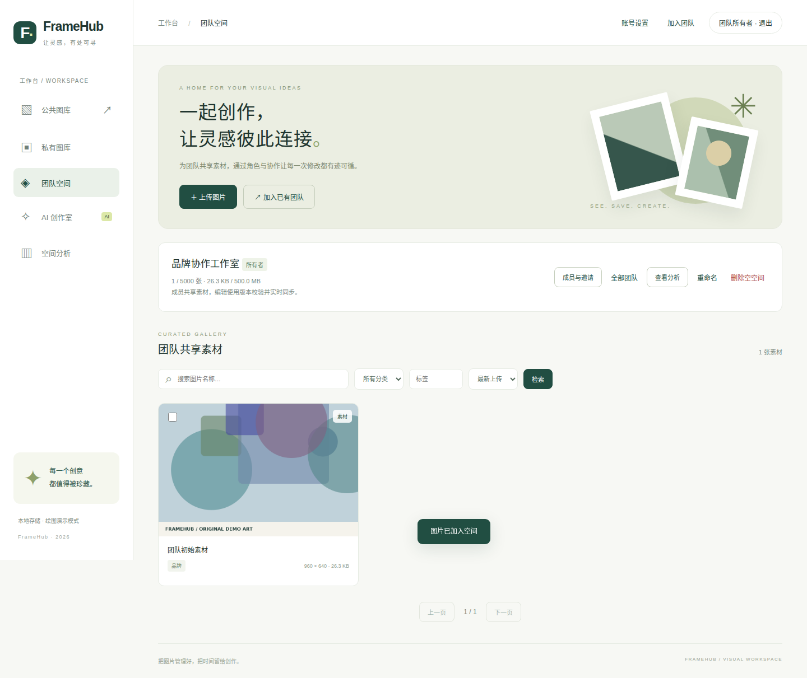
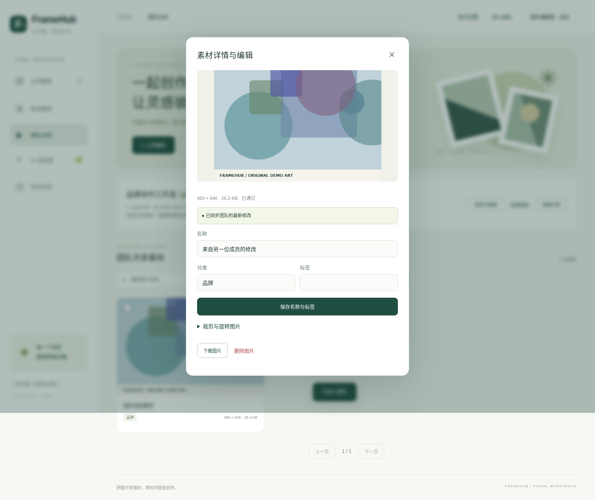
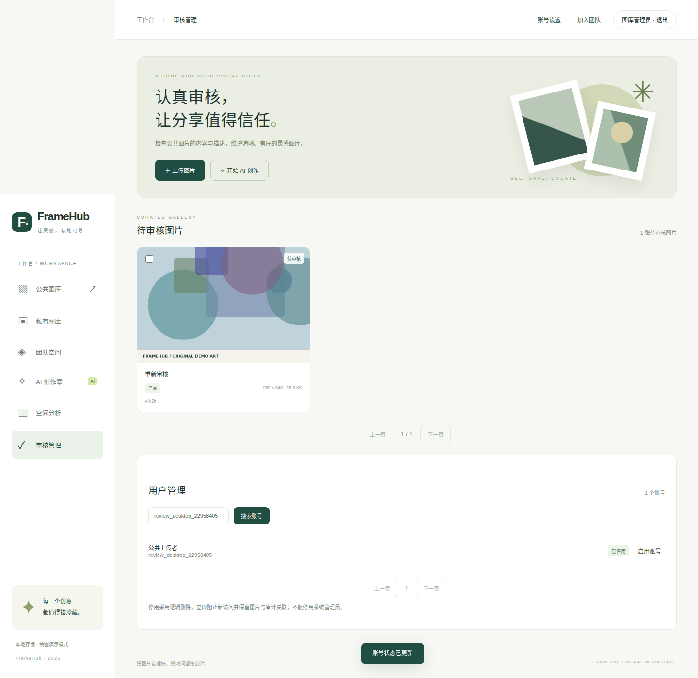
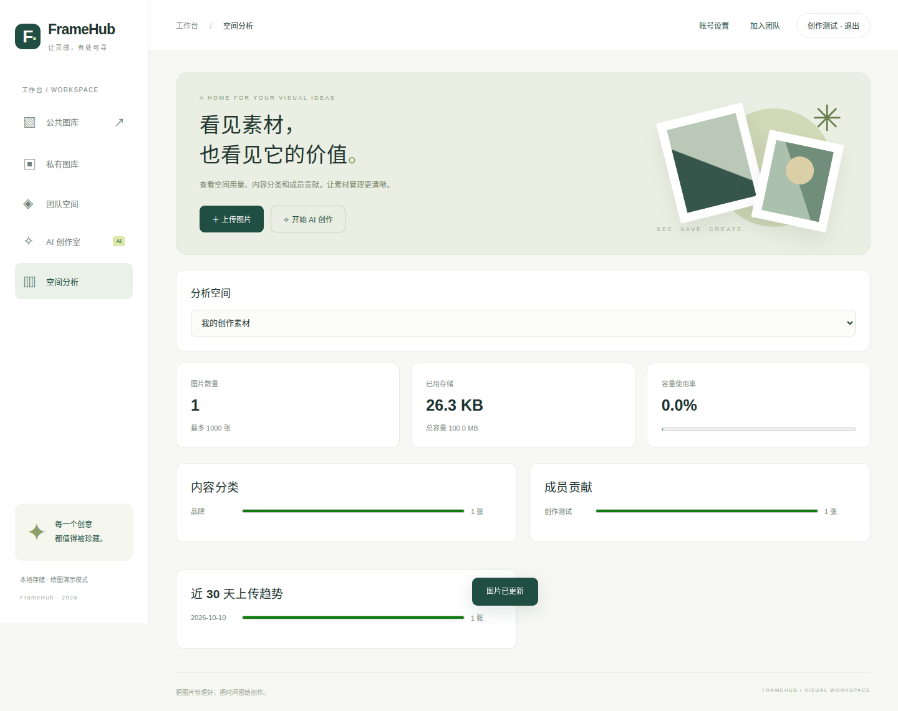

# 实际页面截图

来自 [2026-10-10 自动化验证](https://github.com/ZhouHuimin0111/enterprise-ai-gallery/actions/runs/38039738237)，桌面视口 1440 × 1000，手机视口 390 × 844。画面展示实际接口返回的资料；示例图形和 demo 任务均为程序化生成，不代表真实模型效果。

## 公共图库

## 团队协作

## 管理与分析

## 手机页面

## 完整索引

| 页面 | 桌面 | 手机 |
| --- | --- | --- |
| 公共图库 | [查看](desktop-public.png) | [查看](mobile-public.png) |
| 私有图库 | [查看](desktop-private.png) | [查看](mobile-private.png) |
| 空间分析 | [查看](desktop-analytics.png) | [查看](mobile-analytics.png) |
| 演示创作任务 | [查看](desktop-ai.png) | [查看](mobile-ai.png) |
| 团队图库 | [查看](desktop-team.png) | [查看](mobile-team.png) |
| 协作编辑 | [查看](desktop-collaboration.png) | [查看](mobile-collaboration.png) |
| 审核与账号管理 | [查看](desktop-admin.png) | [查看](mobile-admin.png) |
| Knife4j 文档 | [查看](desktop-api-docs.png) | [查看](mobile-api-docs.png) |
